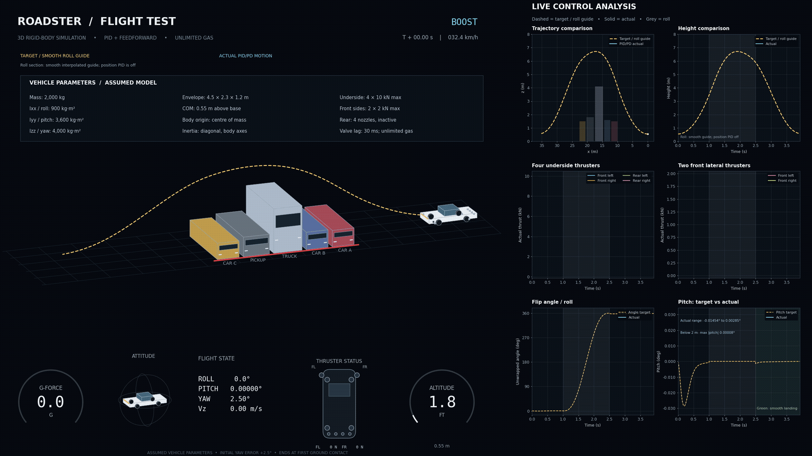
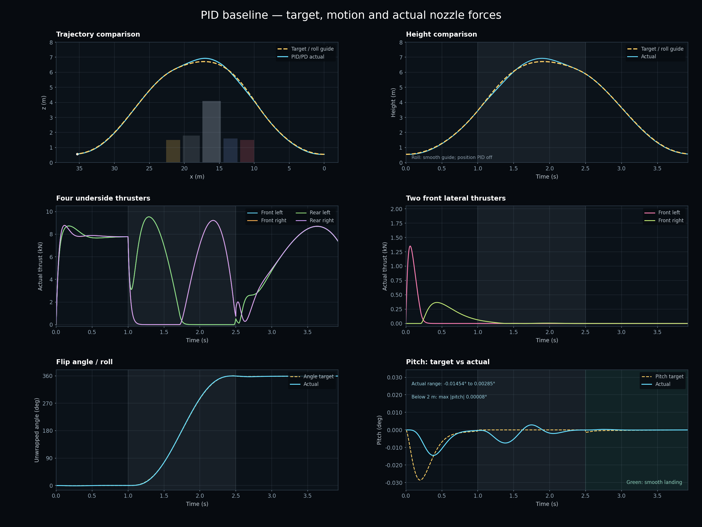

# Roadster Flight Control Simulation

A Roadster-inspired 3D rigid-body simulation exploring how individual thrusters can produce a jump, a full roll, yaw correction and a continuous forward landing. Built in Python with position PID, geometric attitude PD and reference feedforward.



## Why this project exists

Tesla's unveiling of the new Roadster 2 — and its seemingly flying manoeuvres — left me completely stunned. I wanted to understand how the individual thrusters could control such a manoeuvre, so I started with forces, moments and a simple feedback controller.

This small project grew through successive experiments: a 3D jump, a full roll, explicit front lateral yaw jets, a flight-test HUD, live control plots and a smoother landing arc. It was developed by Dashuai Chen with assistance from OpenAI Codex.

The broader inspiration is the ambition to imagine a future, reason from first principles and turn an idea into an experiment. This repository shares the model and its limitations so others can reproduce and examine it.

**This is an independent, assumed vehicle model. It is not a Tesla flight-test reconstruction and does not identify Tesla's actual hardware, gas supply, controller or vehicle parameters. The source video's authenticity is not established by this project.**

## Video

The simulation produces a 2560 × 1440 MP4 and a GIF. The animation above shows the complete flight with live telemetry and control plots. Flight proceeds right to left on screen; forward motion is positive world x.

## What is included

- Force-driven six-degree-of-freedom translation and rotation.
- Four independently controlled underside jets for collective force, roll and pitch moments.
- Two front lateral jets for yaw correction, retaining their coupled lateral force and roll moment.
- Four rear nozzles represented visually but inactive in this scenario.
- A scheduled 360° roll and a continuous forward landing arc.
- A large 3D animation with G-force, altitude, attitude, jet-status and vehicle-parameter displays.
- Six scientific panels: trajectory, height, underside thrusts, lateral thrusts, roll and pitch.
- Logged actual states, forces and commanded orientation, plus nominal and two verification scenarios.

No MPC or reinforcement learning is used in this baseline.

## Quick start

Python 3.10 or newer is required. The requirements use NumPy 2.x because the code calls `numpy.trapezoid`.

```bash
git clone https://github.com/general-chen/roadster-flight-control-sim.git
cd roadster-flight-control-sim
python -m venv .venv
```

Activate the environment:

```bash
# Linux / macOS
source .venv/bin/activate

# Windows PowerShell
.venv\Scripts\Activate.ps1
```

Install dependencies and run the numerical simulation:

```bash
python -m pip install -r requirements.txt
python simulate.py --no-animation
```

Generate the full animation and plots:

```bash
python simulate.py
```

Full rendering also needs **FFmpeg** on PATH. Check the installation with `ffmpeg -version`. On Ubuntu, FFmpeg can be installed with `sudo apt install ffmpeg`; on macOS with Homebrew, `brew install ffmpeg`. On Windows, install an FFmpeg build and add its `bin` directory to PATH.

The simulation runs headlessly using Matplotlib's Agg backend. Numerical execution does not need FFmpeg; video/GIF rendering does. Outputs are written beside `simulate.py`. Rendering time depends on the machine.

To regenerate plots or animation from the included nominal state history:

```python
import shutil
import numpy as np
from analysis_panels import static_plots
from render_3d import render

# Plot annotations use metrics.json beside the source files.
shutil.copyfile('results/nominal/metrics.json', 'metrics.json')
states = np.loadtxt('results/nominal/trajectory.csv', delimiter=',', skiprows=1)
static_plots(states)
render(states)  # Use preview_only=True for three PNG previews without video.
```

## Vehicle assumptions

All values below are simulation choices, not measured Roadster specifications.

| Quantity | Value |
|---|---|
| Constant mass | 2,000 kg |
| Body-frame inertia about COM | diag(900, 3,600, 4,000) kg·m² |
| Body axes | x forward; y left; z up |
| Collision envelope, length × width × height | 4.5 × 2.3 × 1.2 m |
| COM height above lower envelope | 0.55 m |
| Upper envelope relative to COM | +0.65 m |
| Initial forward velocity | 9 m/s (32.4 km/h) |
| Initial yaw error | +2.5° |
| Gravity | 9.81 m/s² |
| Actual actuator response | First-order lag, 30 ms time constant |
| Gas supply | Unlimited; no depletion or pressure model |
| Physics timestep | 0.0025 s |
| Aerodynamics | Not modeled |

`vehicle_parameters.json` records the assumed parameters. **The running model currently reads constants from `simulate.py`; the JSON is documentation, not a configuration input.** Editing only the JSON will not change the simulation. The parameter panel also contains fixed geometry/actuator labels, so update those if modifying the model.

### Thruster geometry

Locations are in metres relative to the COM. Directions below are reaction-force directions on the car, opposite to the visible exhaust direction.

| Index | Jet | Location (x, y, z) | Reaction direction | Force bound |
|---|---|---|---|---|
| 0 | Underside front left | (1.6, 0.8, −0.3) | +z | 0–10 kN |
| 1 | Underside front right | (1.6, −0.8, −0.3) | +z | 0–10 kN |
| 2 | Underside rear left | (−1.6, 0.8, −0.3) | +z | 0–10 kN |
| 3 | Underside rear right | (−1.6, −0.8, −0.3) | +z | 0–10 kN |
| 4 | Front lateral left | (1.9, 1.02, −0.1) | −y | 0–2 kN |
| 5 | Front lateral right | (1.9, −1.02, −0.1) | +y | 0–2 kN |
| 6–9 | Rear nozzles | x = −2; y = 0.70, 0.23, −0.23, −0.70; z = 0 | +x | Inactive |

The underside array provides differential roll and pitch moments. The lateral pair provides yaw torque `1.9 × (F_right − F_left)` N·m; its lateral force and accompanying roll torque are included in the dynamics.

The five assumed stationary obstacles occupy x = 10–22.6 m and y = ±3.5 m. The middle truck is 4.1 m high. These are simplified boxes, not calibrated vehicle meshes.

## Dynamics

With position p, velocity v, body-to-world rotation R and body angular velocity ω:

- Translational force is the sum of the rotated body-frame thruster forces, gravity and an optional prescribed disturbance.
- Body torque is the sum of `r_i × F_i` for the actual lagged jet forces.
- Angular acceleration follows `I ω_dot = τ − ω × (I ω)`.
- Rotation is integrated through incremental rotation matrices; exported quaternions use x/y/z/w ordering.

The actuator update is an exact discrete first-order lag for a held command. Translation uses a constant-acceleration step; rotational increments use the current angular acceleration. A simplified unilateral pad support handles initial valve spool-up.

The simulation stops when the airborne vehicle's collision envelope first contacts the ground. Tire impacts, suspension compression and post-contact rollout are not simulated.

## Controller

### Position and attitude loops

During boost and landing, the outer loop combines reference acceleration with position PID feedback:

```text
acceleration_command = reference_acceleration
                     + Kp * position_error
                     + Kd * velocity_error
                     + Ki * integrated_position_error
```

The integral state is bounded component-wise to ±0.4. Gravity compensation and the desired acceleration define a target thrust direction. A geometric attitude PD loop tracks the corresponding orientation with desired angular-rate feedforward. The roll phase additionally uses scheduled angular-acceleration feedforward.

| Gain | x / roll | y / pitch | z / yaw |
|---|---:|---:|---:|
| Position Kp | 1.8 | 1.8 | 16 |
| Position Kd | 2.5 | 2.5 | 8 |
| Position Ki | 0.05 | 0.05 | 0.2 |
| Attitude Kp | 60,000 | 180,000 | 80,000 |
| Attitude Kd | 14,000 | 50,000 | 32,000 |

The rows represent different control laws and units; the magnitudes are not directly comparable. See the implementation for the rotation-error convention and allocation equations.

Force allocation solves for underside collective force, roll torque and pitch torque, then clips each jet to its bounds. The lateral pair supplies the requested yaw moment within its bounds. Clipping can prevent the requested wrench from being achieved; this is not a constrained optimal allocator.

### Flight phases

| Interval | Translation / attitude behavior |
|---|---|
| 0–1 s | Boost reference; position PID and attitude PD |
| 1–2.5 s | Scheduled 360° roll; position PID suspended |
| From 2.5 s | Adaptive smooth landing reference; position PID and attitude PD |

During the roll, the jets needed for attitude control still exert real translational forces, including when the car is inverted. Rotation is never imposed directly on the actual state.

## Smooth landing reference

At roll completion, a vertical quintic polynomial starts from the measured height, vertical velocity and vertical acceleration. Its mathematical endpoint, 1.6 s later, has COM height 0.548 m and zero vertical velocity and acceleration. This provides C2 continuity for that vertical reference at its endpoints.

Forward target velocity remains positive and constant through descent. There is no hover, forward stop or vertical-only landing segment. A separate lateral quintic gently corrects drift over four seconds, although ground contact interrupts it earlier.

Actual first contact occurs before the mathematical vertical endpoint because the rotated envelope reaches the floor first. The nominal car touches down while moving forward. This is a moving-touchdown scenario, not a stationary landing.

## Reading the plots correctly



- **Yellow dashed:** active position reference, or the labeled interpolated roll guide.
- **Cyan solid:** actual integrated vehicle motion.
- **Grey band:** roll phase, when position PID is inactive.
- **Green pitch-panel band:** smooth landing phase.
- **Thrust curves:** actual actuator forces after response lag.
- **Roll:** unwrapped angle, so one full turn reaches approximately 360°.

### Why there is a complete curve during the roll

A smooth quintic guide bridges the boost target to the adaptive landing target for visualization. It matches position, velocity and acceleration at the boundaries. It uses the measured roll-end handoff state retrospectively, so it is **not an independently prescribed flight plan or an enforced roll-phase position command**.

`display_reference.csv` contains this complete plotted curve and flags the interpolated segment. `control_comparison.csv` leaves the inactive roll-phase position targets as NaN. The raw state CSV retains an older ballistic diagnostic guide in that interval; it should not be interpreted as a controlled target.

### Why pitch is nearly zero

This scenario starts with forward velocity, maintains it through landing, uses symmetric thrust geometry and omits aerodynamic pitching moments. The full flip is a roll about the longitudinal axis. Consequently, actual pitch is small: approximately −0.01454° to +0.00285°.

The pitch panel automatically scales to the actual and commanded variation, rather than using a ±45° axis. HUD pitch is shown to five decimal places. These small variations are characteristics of this simplified scenario, not a claim about an actual flying car.

HUD altitude is COM height. HUD G-force is net thruster-force magnitude divided by mg, excluding gravity and initial pad support. Plume lengths are visual indicators, not a jet-flow calculation.

## Reference results and checks

The included records in `results/nominal/` were generated with the supplied baseline.

| Nominal metric | Result |
|---|---:|
| First ground contact | 3.925 s |
| COM x at contact | 35.324 m |
| Horizontal speed at contact | 9.011 m/s |
| Downward COM speed at contact | 0.378 m/s |
| Downward first-contact-point speed | 0.373 m/s |
| Contact roll error relative to 360° | 0.871° |
| Maximum COM height | 6.925 m |
| Minimum conservative obstacle clearance | 0.266 m |
| Active position-control RMS tracking error | 0.0214 m |

The script also runs:

1. A half-timestep check at 0.00125 s. It retains scenario success; clearance changes by approximately 3.3 mm and vertical COM contact speed by approximately 0.015 m/s.
2. A prescribed disturbance case with an additional 1° initial yaw error and world-y force `700 sin(1.7t)` N. It also meets the scenario criteria.

These are numerical consistency and scenario spot checks, not a broad robustness assessment. Full oriented-box versus obstacle-box collision checks run at each physics step. Conservative clearance uses the lowest point of the rotated envelope whenever horizontal footprints overlap. No continuous swept collision detection is used.

Success requires no obstacle collision, roll completion within 5°, wrapped contact attitude within 5°, angular speed below 0.1 rad/s, horizontal speed within 0.5 m/s of 9 m/s, absolute vertical contact-point speed below 0.5 m/s and the full body beyond the row.

The active-position RMSE excludes the roll interval. The legacy global position RMSE includes the uncontrolled ballistic diagnostic guide and is not a fixed-path tracking score. The interpolated guide should not be used to claim independent path-tracking performance.

## Files and output data

| Path | Purpose |
|---|---|
| `simulate.py` | Dynamics, controller, reference generation, numerical checks and CSV output |
| `render_3d.py` | 3D scene, HUD, parameter panel, MP4/GIF export |
| `analysis_panels.py` | Live plots and standalone figure |
| `display_reference.py` | Full plotted reference including the interpolated roll guide |
| `vehicle_parameters.json` | Documented assumed parameters; not runtime configuration |
| `requirements.txt` | Python dependencies |
| `docs/images/` | Preview and plot sheet |
| `results/nominal/` | Recorded baseline data and verification metrics |

Generated root files include:

| Output | Contents |
|---|---|
| `trajectory.csv` | Time, position, velocity, actual quaternion, body rates, ten actual jet forces, raw phase reference, desired quaternion |
| `control_comparison.csv` | Paired actual/target data, six actual jet forces; phases 0 boost, 1 roll, 3 landing |
| `display_reference.csv` | Complete plotted position curve and interpolated-guide flag |
| `telemetry.csv` | Altitude, thrust-specific G-force, angles, lateral forces, speed and vertical velocity |
| `roll_history.csv` | Unwrapped roll and body-x angular velocity |
| `metrics.json` | Nominal results, half-timestep results and disturbance-case metrics |
| `roadster_smooth_landing.mp4` | 2560 × 1440 animation, 20 fps |
| `roadster_smooth_landing.gif` | 1792 × 1008 preview, 15 fps |
| `control_analysis.png` | 2400 × 1800 plot sheet |
| `hud_launch.png`, `hud_roll.png`, `hud_contact.png` | Three static previews |

CSV headers define names and units. Positions use metres, forces newtons, times seconds, quaternions x/y/z/w and angular rates radians/s unless the column name explicitly says degrees.

## Scope and limitations

The model omits aerodynamic drag/lift/moments, gas blowdown, changing mass/inertia, structural flexibility, thermal effects, sensors and estimation, contact/impact dynamics and post-contact tire behavior. Its assumed geometry, initial speed and scheduled manoeuvre are selected to explore control mechanics.

The baseline is an educational and exploratory simulation, not a validated vehicle design, a hardware controller or evidence that a real vehicle uses this method.

## Credits

Project by **Dashuai Chen**, developed with assistance from **OpenAI Codex**. The simulation graphics are generated by this project. Tesla and Roadster names are used to describe the inspiration; this project has no affiliation with Tesla or SpaceX.

No license has been selected yet. A license can be added by the repository owner before inviting reuse under specific terms.
